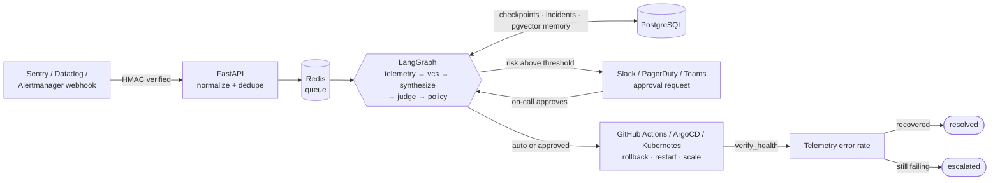

<div align="center">

```
 ____           _ _ _          _    ___
|  _ \ ___  ___(_) (_) ___    / \  |_ _|
| |_) / _ \/ __| | | |/ _ \  / _ \  | |
|  _ <  __/\__ \ | | | (_) |/ ___ \ | |
|_| \_\___||___/_|_|_|\___//_/   \_\___|
```

**The autonomous incident responder that checks its own work.**

Alert in → evidence fingerprinted → root cause hypothesized → *hallucinations caught by an LLM-as-a-judge* →
risk-tiered approval → rollback → verified against live telemetry.

[](LICENSE)
[](https://github.com/CoderHariswar/resilio-ai/actions/workflows/ci.yml)
[](pyproject.toml)
[](pyproject.toml)
[](https://github.com/astral-sh/ruff)

[Quickstart](#quickstart-in-30-seconds) · [Architecture](docs/ARCHITECTURE.md) · [Providers](#providers) · [Write a plugin](docs/CONTRIBUTING.md#build-a-provider-in-under-50-lines) · [Roadmap](#contributor-roadmap)

</div>

---

## Why ResilioAI

Most "AI SRE" demos stop at a chatbot summarizing logs. The hard parts of letting an agent touch
production are everything around the LLM:

- **It must not act on hallucinations.** Every hypothesis must cite evidence fingerprints and a rollback
  SHA that actually exist. Deterministic grounding checks plus an LLM-as-a-judge reject anything else and
  send it back for revision.
- **Humans stay in control of risk.** A policy engine, not the model, decides what runs automatically.
  Rolling back a critical service in production pauses for approval. The pause is a durable LangGraph
  checkpoint in PostgreSQL that survives restarts.
- **Remediation is verified.** An incident is `resolved` only after the error rate actually recovers.
  Otherwise it escalates to a human with the full analysis attached.
- **It plugs into your stack.** Telemetry, remediation, notification and LLM backends are small async
  adapters. Adding one is a single file of under 50 lines.
- **It runs offline.** Mock Mode needs zero API keys, and `LLM_PROVIDER=ollama` or `vllm` keeps inference
  on your network.

```text
$ docker compose exec api resilio dev simulate --type memory-leak

 telemetry        240 traces -> 8 fingerprints (95.5% token savings); 0 similar incidents
 vcs              onset follows deploy 6e1214e0 ('feat(catalog): warm in-process product cache
                  on startup'); rollback target c78f3cba
 synthesizer      hypothesis: memory_leak -> rollback (confidence 0.98)
 evaluator        rejected, requesting revision 1/2: target_sha deadbeefcafe0000000000000000000000000000
                  not found in deployment history
 synthesizer      revised hypothesis: memory_leak -> rollback (confidence 0.98)
 evaluator        accepted (score 1.00)
 policy           risk=high decision=approval
 request_approval approval requested from on-call

Incident 76ad0d11-…  awaiting_approval
Waiting for a human. Run resilio approve 76ad0d11-… or resilio reject 76ad0d11-…
```

*(Real output. In Mock Mode the simulated LLM deliberately invents a commit SHA on some first attempts,
so you can watch the evaluator catch it.)*

## Quickstart in 30 seconds

No API keys, no Datadog account, no Slack workspace:

```bash
git clone https://github.com/CoderHariswar/resilio-ai.git
cd resilio-ai
docker compose up -d --build
docker compose exec api python -m resilio.cli dev simulate --type memory-leak
```

Then approve the rollback it proposes:

```bash
docker compose exec api resilio status            # pending approvals, read from PostgreSQL
docker compose exec api resilio approve <incident-id>
docker compose logs -f api                        # terminal notifications land here
open http://localhost:8000/ui/incidents/<incident-id>   # review page with Approve / Reject
curl -s localhost:8000/metrics | grep ^resilio_
```

<details>
<summary>No Docker? Run everything in-process with uv</summary>

```bash
uv sync
uv run resilio dev simulate --type memory-leak --local     # prompts you to approve
uv run resilio dev simulate --type disk-full --local       # low risk → auto-remediates
uv run resilio dev simulate --type cert-expiry --local     # no safe action → escalates
uv run resilio dev scenarios                               # all 10 outage types
```
</details>

Port 8000 taken? `RESILIO_PORT=18000 docker compose up -d`.

## Architecture



| Stage | What happens |
|---|---|
| **Telemetry** | Fetch error traces, redact secrets/PII, collapse into fingerprinted groups (~95% fewer prompt tokens), retrieve similar past incidents |
| **VCS** | Correlate error onset with deployment history; the deploy *before* the suspect is the only legal rollback target |
| **Synthesizer** | LLM proposes root cause, evidence, action, target SHA, confidence |
| **Evaluator** | Grounding checks (fabricated fingerprints/SHAs are fatal) + LLM-as-a-judge; up to `MAX_EVALUATOR_RETRIES` revisions |
| **Policy** | Risk tiering → `auto`, `approval` (LangGraph `interrupt()`), or `escalate` |
| **Remediation** | Execute, then poll health until recovered or `HEALTH_CHECK_TIMEOUT_SECONDS` |

Sequence diagrams, the state machine, and the security model are in **[docs/ARCHITECTURE.md](docs/ARCHITECTURE.md)**.

## Why not a vector DB?

ResilioAI's "memory" is one embedding per *resolved incident*: thousands of rows a year, not billions.
It lives in **PostgreSQL with pgvector**, next to the incident rows and the LangGraph checkpoints:

- **One stateful dependency.** The system you rely on during an outage has fewer things that can be down.
  Backup is `pg_dump`.
- **Consistency.** Status, checkpoint, and memory share a database instead of drifting across two.
- **Hybrid queries in one statement.** Relational filters, vector ranking, and JSONB projection in one SQL query.
- **Fast enough to be invisible.** Measured on a laptop with the real schema: **100k × 256-d vectors, HNSW
  top-3 in 1.19 ms p50 / 1.80 ms p99** including the client round-trip, and 1.44 ms p50 with a service
  filter. A single LLM call takes 1–10 s.
- **Air-gap friendly.** No incident text is sent to a SaaS vector store.

The trade-offs, the HNSW-with-filters caveat, and when we'd revisit are in
**[ADR 0001](docs/ADR/0001-postgresql-over-vectordb.md)**.
Why LangGraph checkpoints hold the human-in-the-loop state is in
**[ADR 0002](docs/ADR/0002-langgraph-for-hitl-state.md)**.

## Providers

Select providers with environment variables (see [`.env.example`](.env.example)). Unconfigured
credentials fail fast at startup with a clear message.

| Kind | Setting | Built-in providers |
|---|---|---|
| Telemetry | `TELEMETRY_PROVIDER` | `opentelemetry` (Jaeger query API) · `datadog` · `sentry` · `prometheus` · `mock` |
| Remediation | `REMEDIATION_PROVIDER` | `github_actions` (workflow_dispatch) · `argocd` · `kubernetes` (API server, no kubectl) · `mock` |
| Notifications | `NOTIFIERS` (comma list) | `slack` · `pagerduty` (Events v2, auto-resolve) · `teams` (Adaptive Cards) · `terminal` · `mock` |
| LLM | `LLM_PROVIDER` | `openai` · `anthropic` · `deepseek` · `ollama` · `vllm` (air-gapped) · `mock` |

```bash
# Example: Datadog evidence, ArgoCD rollbacks, Slack + PagerDuty, local Llama via Ollama
TELEMETRY_PROVIDER=datadog DATADOG_API_KEY=... DATADOG_APP_KEY=...
REMEDIATION_PROVIDER=argocd ARGOCD_URL=https://argocd.internal ARGOCD_TOKEN=...
NOTIFIERS=slack,pagerduty SLACK_WEBHOOK_URL=... PAGERDUTY_ROUTING_KEY=...
LLM_PROVIDER=ollama LLM_BASE_URL=http://ollama:11434/v1 LLM_MODEL=llama3.1:8b
```

Third-party packages can register providers through entry points (`resilio.telemetry`,
`resilio.remediation`, `resilio.notifiers`, `resilio.llm`). `resilio providers` lists what's installed.

## Webhooks

| Endpoint | Source |
|---|---|
| `POST /api/v1/webhooks/sentry` | Sentry issue alerts |
| `POST /api/v1/webhooks/datadog` | Datadog monitor webhooks (default JSON template); recoveries ignored |
| `POST /api/v1/webhooks/alertmanager` | Prometheus Alertmanager (one incident per firing alert) |
| `POST /api/v1/webhooks/generic` | Any JSON matching `IncidentEvent` |

Set `WEBHOOK_SECRET` to require `X-Resilio-Signature: sha256=HMAC(secret, "<ts>.<body>")` with
`X-Resilio-Timestamp` (5-minute replay window). Set `API_TOKEN` to require a bearer token on approvals.
Try the real ingestion path with vendor-shaped payloads:

```bash
python scripts/mock_outage_simulator.py --type bad-deploy --source sentry
python scripts/mock_outage_simulator.py --type traffic-spike --source datadog --storm 20   # alert storm → 1 incident
```

## CLI

| Command | Purpose |
|---|---|
| `resilio dev simulate --type memory-leak` | Fire a synthetic incident at the running server (`--local` runs in-process) |
| `resilio dev replay <incident-id \| payload.json>` | Re-run a past incident or a captured webhook |
| `resilio dev scenarios` | List the 10 synthetic outage types |
| `resilio status` | Pending human-in-the-loop checkpoints (from PostgreSQL when `DATABASE_URL` is set) |
| `resilio approve <id>` / `resilio reject <id>` | Decide a paused remediation |
| `resilio show <id>` | Timeline and outcome of an incident |
| `resilio eval run` | 50-scenario offline benchmark: judge precision, hallucination rates |
| `resilio eval seed` | Write the benchmark to `benchmarks/scenarios.json` for editing |
| `resilio providers` | Active and available providers |
| `resilio serve --reload` | API with hot reload |

## Evaluating the judge

```bash
resilio eval run                      # deterministic rules baseline (no keys)
resilio eval run --llm openai         # score a real model on the same 50 scenarios
resilio eval run --llm ollama --min-precision 0.95 --max-hallucination-escape 0.0   # CI gate
```

Every scenario carries a labelled candidate RCA. Each of 10 outage types has 5 variants: three correct,
one with a **fabricated SHA or fingerprint**, and one with a **plausible but wrong root cause**. The report
covers judge precision and recall, *hallucination escape rate* (fabrications accepted), *misattribution
escape rate*, and end-to-end RCA accuracy, along with how often the evaluator had to correct the synthesizer.

### Results

Both local models ran with the same prompts on the same 50 scenarios, on a laptop RTX 3050 Ti (4 GB).

| Metric | Rules baseline (`mock`) | `llama3.2:3b` | `qwen2.5:7b` |
|---|---|---|---|
| Judge precision (accepted RCAs that were correct) | 100% | 80.6% | 90.6% |
| Judge recall (correct RCAs accepted) | 100% | 96.7% | 96.7% |
| Hallucination escape rate (fabricated SHA/evidence accepted) | 0% | **0%** | **0%** |
| Misattribution escape rate (wrong root cause accepted) | 0% | **70%** | **30%** |
| End-to-end root-cause accuracy | 100% | 66% | 92% |
| End-to-end action accuracy | 100% | 50% | 78% |
| First-pass hallucination rate (caught and corrected) | 26% | 18% | 6% |
| Escalated with no accepted RCA | 0% | 4% | 0% |
| Wall time, 50 scenarios | 0.04 s | 13.3 min | 31.7 min |

What the numbers mean:

- **Fabrications never get through, with any model.** Invented commit SHAs and evidence fingerprints are
  caught by the deterministic grounding checks, which don't depend on the LLM.
- **Catching a plausible but wrong root cause scales with model size.** The 3B judge let 7 of 10
  through; the 7B judge let 3 through. Neither is good enough to act unsupervised, which is why
  `AUTO_APPROVE_MAX_RISK` defaults to `low`: a human approves every rollback until you have benchmarked
  your own model.
- **Bigger models also hallucinate less in the first place** (18% → 6% of first answers needed a
  correction) and pick the right root cause far more often (66% → 92%).
- **The rules baseline scoring 100% is expected, not impressive.** The scenarios are generated from the
  same templates its rules were written for. It's a sanity check, not a target.

The benchmark already earned its keep: the first run with a real model showed the original judge prompt
rejecting *every* correct analysis, because it demanded proof of causality. The calibrated prompt in
[`prompts.py`](resilio/graph/prompts.py) fixed that (recall went from 0% on a 5-scenario smoke test to
96.7% on the full run). Run it on your own model and prompt changes, and add your historical incidents
to the scenario file.

## Self-observability

`GET /metrics` exposes the agent's own health in Prometheus format
(`docker compose --profile observability up` starts Prometheus on :9090):

| Metric | |
|---|---|
| `resilio_incidents_total{status="resolved\|escalated\|failed"}` | outcomes |
| `resilio_token_savings_percent` | prompt-token reduction from fingerprinting |
| `resilio_evaluator_corrections_total` | hallucinated or ungrounded hypotheses sent back |
| `resilio_resolution_duration_seconds{status}` | alert → terminal state |
| `resilio_hitl_pending`, `resilio_incidents_deduplicated_total`, `resilio_llm_tokens_total`, `resilio_node_duration_seconds`, `resilio_provider_errors_total` | operations |

## Safety defaults

- `AUTO_APPROVE_MAX_RISK=low`: only restarts and scale-ups run unattended. Every production rollback asks
  a human. Set it to `none` for a suggest-only rollout.
- Rollbacks may only target the deploy *before* the one correlated with error onset, never a model-invented SHA.
- No safe action (third-party outage, expired certificate) means escalation, not a guess.
- Secrets and PII are redacted before evidence reaches any LLM and from every log line.

## Development

```bash
make install      # uv sync --extra dev
make hooks        # pre-commit: ruff, mypy --strict, pytest
make dev          # API with hot reload on :8000
make check        # lint + typecheck + 200+ tests (~95% coverage)
make test-pg      # integration tests against a throwaway pgvector container
docker compose watch   # hot-reload inside the container stack
```

```
resilio/
├── main.py  api/  ingest.py  worker.py  container.py  cli.py
├── graph/        state.py · workflow.py · prompts.py · nodes/
├── providers/    base.py · registry.py · telemetry/ · remediation/ · notifications/ · llm/
├── core/         database.py · queue.py · metrics.py · security.py
└── utils/        log_sanitizer.py · evaluator_benchmark.py · embeddings.py
```

## Contributor Roadmap

New adapters are the best first contribution. Each is **one file plus a test**, following the
[50-line guide](docs/CONTRIBUTING.md#build-a-provider-in-under-50-lines).
[Open a provider request](https://github.com/CoderHariswar/resilio-ai/issues/new?template=03_new_provider.yml).

- **Telemetry:** help us build adapters for **Dynatrace**, **New Relic** (a tested starter is in
  [`examples/`](examples/newrelic_telemetry.py)), **Grafana Tempo/Loki**, **Elastic/OpenSearch**, **Honeycomb**.
- **Remediation:** **GitLab CI**, **Spinnaker / Argo Rollouts**, **AWS ECS**, **Nomad**, **Helm**.
- **Notifications:** **Opsgenie**, **Discord**, **Google Chat**, **Mattermost**, interactive Slack buttons.
- **LLMs:** **Google Gemini**, **Azure OpenAI**, **AWS Bedrock**.
- **Ingest:** Grafana, New Relic and Opsgenie webhook normalizers.
- **Core:** retention job for checkpoints, model-backed embedders, Helm chart, per-service runbooks fed to
  the synthesizer, a richer review UI.

See [CONTRIBUTING.md](docs/CONTRIBUTING.md) to get started. Significant design changes go through an
[ADR](docs/ADR/README.md).

## Status

Alpha. The architecture, safety rails, and Mock Mode are complete and tested. The real-world adapters are
implemented against vendor APIs and tested with recorded responses, but need mileage in more environments.
Bug reports from real stacks are very welcome.

## License

[Apache License 2.0](LICENSE)
