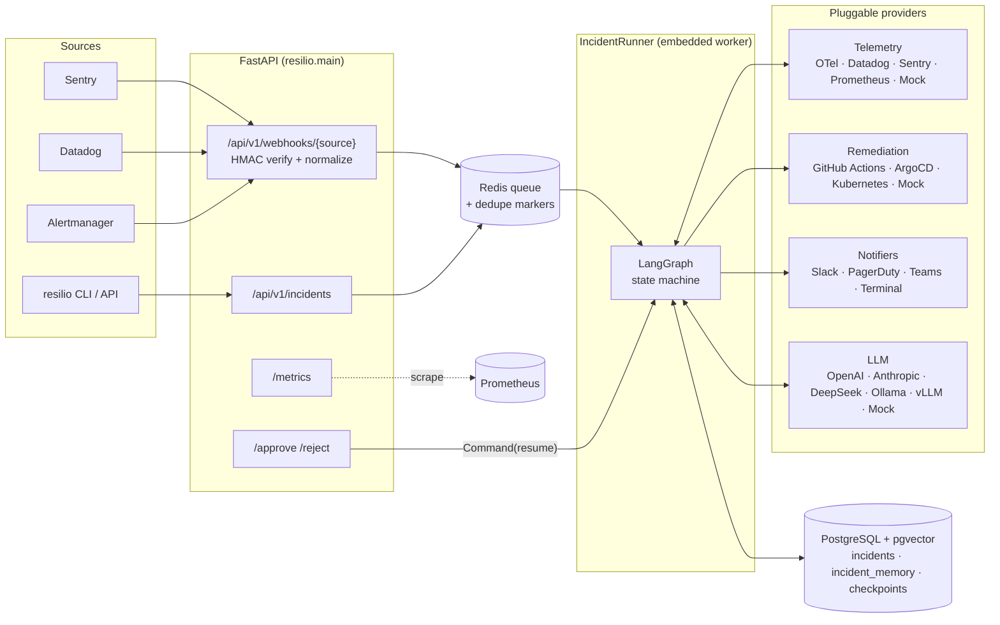
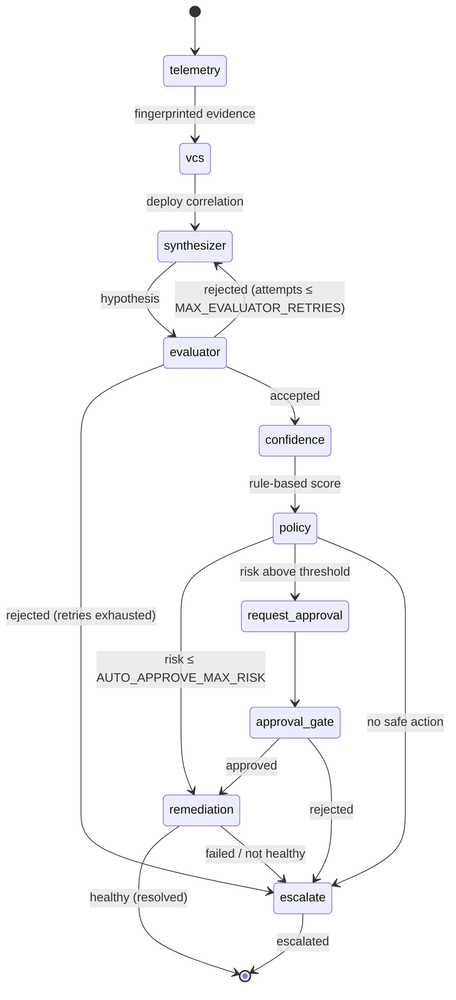
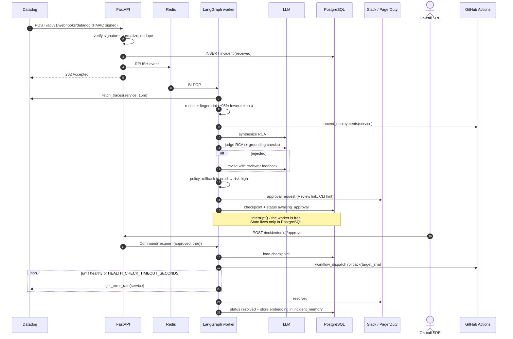

# Architecture

ResilioAI turns an alert into a verified root-cause analysis and, when policy
allows, a remediation that is checked against live telemetry before the
incident is closed. This document describes the moving parts and the design
constraints behind them.

- [System overview](#system-overview)
- [The incident state machine](#the-incident-state-machine)
- [Human-in-the-loop sequence](#human-in-the-loop-sequence)
- [Why the evaluator exists](#why-the-evaluator-exists)
- [Risk-tiered policy engine](#risk-tiered-policy-engine)
- [Token economics](#token-economics)
- [Persistence](#persistence)
- [Provider model](#provider-model)
- [Self-observability](#self-observability)
- [Security model](#security-model)
- [Code map](#code-map)

## System overview



**Request path.** Webhooks are verified, normalized into a provider-neutral
`IncidentEvent`, deduplicated (one open incident per
`environment:service:title`), persisted and queued. The HTTP response returns
in milliseconds; investigation happens asynchronously.

**Worker.** `IncidentRunner` consumes the queue with bounded concurrency
(`WORKER_CONCURRENCY`) and drives one LangGraph thread per incident
(`thread_id = incident_id`). It is the only component that writes incident
status, which keeps the graph nodes free of persistence concerns.

## The incident state machine



| Node | Responsibility | Module |
|---|---|---|
| `telemetry` | Fetch traces, redact secrets/PII, collapse into fingerprinted groups, look up similar past incidents | [`telemetry_node.py`](../resilio/graph/nodes/telemetry_node.py) |
| `vcs` | Read deployment history; if the newest deploy precedes error onset (≤ 6 h), mark it *suspect* and pick the previous SHA as the only legal rollback target | [`vcs_node.py`](../resilio/graph/nodes/vcs_node.py) |
| `synthesizer` | LLM proposes `{root_cause, evidence[], action, target_sha, confidence}` | [`synthesizer_node.py`](../resilio/graph/nodes/synthesizer_node.py) |
| `evaluator` | Deterministic grounding checks + LLM-as-a-judge; rejections carry revision feedback | [`evaluator_node.py`](../resilio/graph/nodes/evaluator_node.py) |
| `confidence` | Score the accepted hypothesis from verified signals; keep the model's own number as `llm_confidence` | [`confidence_node.py`](../resilio/graph/nodes/confidence_node.py) |
| `policy` | Risk tiering and the auto / approval / escalate decision | [`policy_node.py`](../resilio/graph/nodes/policy_node.py) |
| `request_approval` / `approval_gate` | Notify on-call, then `interrupt()` until a human decides | [`approval_node.py`](../resilio/graph/nodes/approval_node.py) |
| `remediation` | Execute rollback / restart / scale, then `verify_health` | [`remediation_node.py`](../resilio/graph/nodes/remediation_node.py) |
| `escalate` | Hand off to humans with the best hypothesis attached | [`escalation_node.py`](../resilio/graph/nodes/escalation_node.py) |

Every node is built by a `make_*_node(deps)` factory, receives its providers
through `WorkflowDeps`, reads and writes only JSON-serializable state, and
appends to a shared `timeline` (an `operator.add` reducer). That is what makes
the graph checkpointable and every incident replayable.

## Human-in-the-loop sequence



The approval can arrive hours later, on a different replica, after a deploy
of ResilioAI itself: the checkpoint is the only state needed to continue.
`tests/integration/test_postgres.py::test_hitl_checkpoint_survives_process_restart`
proves this with two independent containers.

## Why the evaluator exists

LLMs produce fluent root-cause analyses that cite commits that do not exist.
For an agent that can roll back production, that is the most dangerous
failure mode, so the evaluator is split into two layers:

1. **Grounding checks** ([`check_grounding`](../resilio/graph/nodes/evaluator_node.py))
   are deterministic and always fatal: every cited fingerprint must exist in
   the evidence; a rollback SHA must exist in the deployment history and must
   not be the currently deployed version; confidence must be in `[0, 1]`; the
   action must be a known enum value.
2. **LLM-as-a-judge** reviews semantics: does the root cause explain the
   *most frequent* evidence, does the action address it, is confidence
   justified? It returns concrete feedback that is fed back to the synthesizer.

A hypothesis is accepted only if both pass and the judge's score is at least
`EVALUATOR_MIN_SCORE`. Each rejection that leads to a revision increments
`resilio_evaluator_corrections_total`. After `MAX_EVALUATOR_RETRIES` the
incident escalates rather than acting on an unverified plan. If the judge LLM
is unreachable, grounding checks still run, and the policy engine raises the
risk tier by one so that a human looks at it.

Quality is measured offline by `resilio eval run` (see
[`evaluator_benchmark.py`](../resilio/utils/evaluator_benchmark.py)).

## Risk-tiered policy engine

| Signal | Effect |
|---|---|
| `restart`, `scale_up` | base **low** |
| `rollback` | base **medium** |
| service in `CRITICAL_SERVICES` | +1 tier |
| alert severity `critical` | +1 tier |
| rule-based confidence < `MIN_AUTO_CONFIDENCE` | +1 tier |
| judge unavailable | +1 tier |
| environment ≠ `production` | −1 tier (floor low) |
| action `none` | always escalate |

The decision is `auto` when the tier is ≤ `AUTO_APPROVE_MAX_RISK` (default
`low`), otherwise `approval`. Set `AUTO_APPROVE_MAX_RISK=none` for a
"suggest-only" rollout where every action needs a human.

## Confidence scoring

The confidence above is computed by the `confidence` node, never taken from
the LLM ([ADR 0003](ADR/0003-rule-based-confidence.md)). The default
`WeightedRuleScorer` ([`scoring/confidence.py`](../resilio/scoring/confidence.py))
weights five signals:

| Signal | Raw score | Default weight |
|---|---|---|
| `deploy_timing` | 1.0 if the suspect deploy is ≤ 30 min before onset, 0.5 if ≤ 6 h, else 0; rollbacks only | 0.30 |
| `dominant_error` | share of all error lines in the cited fingerprint groups | 0.20 |
| `judge_score` | the judge's score; skipped when the judge is unavailable | 0.30 |
| `first_try` | 1.0 / 0.5 / 0.25 for 0 / 1 / 2+ revisions | 0.10 |
| `past_match` | similarity of the closest past incident with the same root cause, if ≥ 0.5 | 0.10 |

A skipped signal's weight is shared among the others in proportion. Then
rules apply in order: by default a rollback with no suspect deploy is capped
at 0.4, and a missing judge multiplies the score by 0.8. Weights and rules are
read from `confidence.yaml` ([example](../confidence.example.yaml)); see the
[contributor guide](CONTRIBUTING.md#tuning-confidence) for a worked example.
Confidence only feeds the `+1 tier` rule above, so it can never skip the
approval gate on its own.

## Token economics

Raw error logs are extremely repetitive. Before anything reaches a model,
[`log_sanitizer.compact_traces`](../resilio/utils/log_sanitizer.py):

1. redacts credentials, tokens, emails, IPs and card numbers;
2. normalizes volatile tokens (numbers, UUIDs, hex, timestamps, quoted strings);
3. groups by `sha256(error_type | template)[:12]`;
4. keeps the top 20 groups with counts, first/last seen and three trace IDs.

On the bundled scenarios this removes ~95% of prompt tokens (240 traces → 8
fingerprints). The fingerprint is also the unit of citation: the LLM must
reference evidence by fingerprint, which is what makes hallucinated evidence
mechanically detectable. The latest ratio is exported as
`resilio_token_savings_percent`.

## Persistence

| Store | Contents | Without it |
|---|---|---|
| PostgreSQL `incidents` | lifecycle row + summary (hypothesis, policy, timeline) | in-memory dict |
| PostgreSQL `incident_memory` (pgvector) | 256-d embeddings of resolved incidents | in-memory cosine search |
| LangGraph checkpoint tables | full graph state per incident | `InMemorySaver` (HITL does not survive restarts) |
| Redis | durable queue + dedupe markers (`SET NX EX`) | `asyncio.Queue` |

Everything degrades to in-process implementations, which is how
`resilio dev simulate --local` and the test suite run without any services.
See [ADR 0001](ADR/0001-postgresql-over-vectordb.md) for why there is no
separate vector database and [ADR 0002](ADR/0002-langgraph-for-hitl-state.md)
for the checkpointing design.

Dedupe markers are released when an incident **resolves** or **fails**, so a
recurrence gets a fresh investigation. Escalated incidents keep their marker
for `DEDUPE_WINDOW_SECONDS`: a human owns them now, and a still-firing alert
must not page again.

## Provider model

```mermaid
classDiagram
    class BaseTelemetryProvider {
        <<abstract>>
        +fetch_traces(service, lookback_minutes) list~dict~
        +get_error_rate(service) float | None
    }
    class BaseRemediationProvider {
        <<abstract>>
        +execute_rollback(service, target_sha) bool
        +verify_health(service, timeout_seconds) bool
        +recent_deployments(service, limit) list~Deployment~
        +restart_service(service) bool
        +scale_service(service, delta) bool
    }
    class BaseNotifier {
        <<abstract>>
        +send(notification) bool
    }
    class BaseLLMProvider {
        <<abstract>>
        +complete(LLMRequest) LLMResponse
    }
    BaseTelemetryProvider <|-- DatadogTelemetryProvider
    BaseTelemetryProvider <|-- SentryTelemetryProvider
    BaseTelemetryProvider <|-- PrometheusTelemetryProvider
    BaseTelemetryProvider <|-- OpenTelemetryProvider
    BaseTelemetryProvider <|-- MockTelemetryProvider
    BaseRemediationProvider <|-- GitHubActionsRemediationProvider
    BaseRemediationProvider <|-- ArgoCDRemediationProvider
    BaseRemediationProvider <|-- KubernetesRemediationProvider
    BaseRemediationProvider <|-- MockRemediationProvider
    BaseNotifier <|-- SlackNotifier
    BaseNotifier <|-- PagerDutyNotifier
    BaseNotifier <|-- TeamsNotifier
    BaseNotifier <|-- TerminalNotifier
    BaseLLMProvider <|-- OpenAICompatibleProvider
    OpenAICompatibleProvider <|-- OpenAIProvider
    OpenAICompatibleProvider <|-- DeepSeekProvider
    OpenAICompatibleProvider <|-- OllamaProvider
    OpenAICompatibleProvider <|-- VLLMProvider
    BaseLLMProvider <|-- AnthropicProvider
    BaseLLMProvider <|-- MockLLMProvider
```



Providers are resolved by name from settings (`TELEMETRY_PROVIDER=datadog`)
through [`registry.py`](../resilio/providers/registry.py): runtime
registrations first, then lazily imported built-ins, then installed packages
exposing entry points in the `resilio.telemetry`, `resilio.remediation`,
`resilio.notifiers` or `resilio.llm` groups. Each class builds itself with a
`from_settings` classmethod and fails fast with a clear message when a
credential is missing.

All HTTP providers share one client factory and retry policy
([`providers/http.py`](../resilio/providers/http.py)): exponential backoff on
network errors and `408/425/429/5xx`, immediate failure otherwise. They accept
an injected `httpx.AsyncClient`, so tests use `httpx.MockTransport` and never
touch the network.

**Mock Mode** is not a stub. `MockTelemetryProvider` generates hundreds of
noisy, timestamped log lines for ten outage types,
`MockRemediationProvider` keeps a plausible deploy history and only "heals"
a service when the action matches the scenario, and `MockLLMProvider` reasons
with transparent rules (and deliberately hallucinates on a configurable
fraction of first attempts so the evaluator loop is visible).

## Self-observability

| Metric | Type | Meaning |
|---|---|---|
| `resilio_incidents_total{status}` | counter | terminal outcomes: `resolved`, `escalated`, `failed` |
| `resilio_token_savings_percent` | gauge | prompt-token reduction on the latest incident |
| `resilio_evaluator_corrections_total` | counter | hypotheses sent back for revision |
| `resilio_resolution_duration_seconds{status}` | histogram | ingestion → terminal state (includes human wait) |
| `resilio_incidents_received_total{source}` | counter | accepted alerts |
| `resilio_incidents_deduplicated_total` | counter | alert-storm duplicates dropped |
| `resilio_hitl_pending` | gauge | incidents paused at the approval gate |
| `resilio_llm_tokens_total{provider,kind}` | counter | prompt / completion tokens |
| `resilio_node_duration_seconds{node}` | histogram | per-node latency |
| `resilio_provider_errors_total{kind,provider}` | counter | upstream failures |
| `resilio_confidence_score` | histogram | rule-based confidence of accepted hypotheses |
| `resilio_llm_confidence_delta` | histogram | rule-based minus the model's self-reported confidence |

Useful alerts on the agent itself: `resilio_hitl_pending > 0 for 30m`
(approvals are being ignored), a rising
`rate(resilio_evaluator_corrections_total[1h])` (model quality regression),
and `resilio_provider_errors_total` by provider.

## Security model

- **Inbound**: webhook bodies are authenticated with HMAC-SHA256 over
  `"<timestamp>.<body>"` and a ±5 minute replay window when `WEBHOOK_SECRET`
  is set. Mutating API calls require `Authorization: Bearer $API_TOKEN` when
  it is set. Comparisons are constant-time.
- **Outbound to LLMs**: only redacted, fingerprinted evidence leaves the
  process. For data-residency requirements, `LLM_PROVIDER=ollama` or `vllm`
  keeps inference on your network on the same code path.
- **Logs**: every log record passes through `SecretScrubbingFilter`.
- **Blast radius**: remediation providers need only narrow permissions (see
  the docstrings, e.g. Kubernetes needs get/list/patch on `deployments` and
  get/list on `replicasets`). The policy engine, not the LLM, decides whether
  an action runs without a human.
- **Containers** run as an unprivileged user (`uid 10001`).

## Code map

```
resilio/
├── main.py              FastAPI app factory, lifespan, /healthz /readyz /metrics
├── api/routes.py        webhooks, incidents, approve/reject, review page
├── ingest.py            vendor payload → IncidentEvent
├── container.py         composition root (providers, storage, graph, runner)
├── worker.py            IncidentRunner: run / resume / sync status / metrics
├── graph/               state schema, workflow, prompts, nodes
├── providers/           ABCs, registry, http helper, telemetry/ remediation/ notifications/ llm/
├── core/                database (Postgres + in-memory), queue, metrics, security
├── scoring/             rule-based confidence scorer and its YAML config
├── utils/               log_sanitizer, embeddings, llm_json, evaluator_benchmark
├── scenarios.py         synthetic outage library shared by mocks and the benchmark
└── cli.py               `resilio` developer CLI
```
